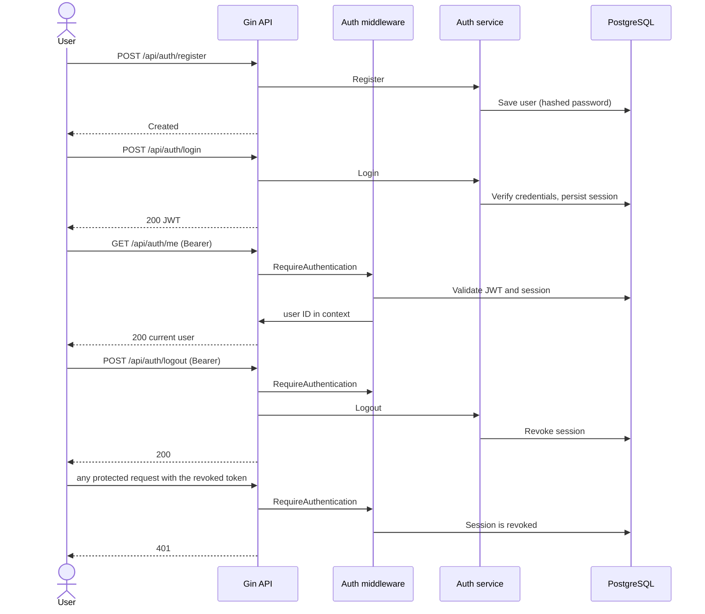
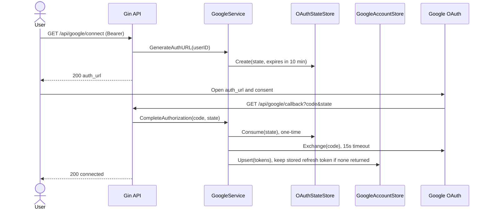
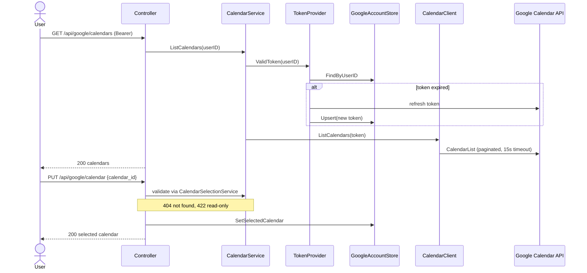

# Go Calendar Booking

A backend API for booking appointments that stay in sync with Google Calendar.
Users register and log in, connect their Google account, choose one calendar for bookings,
and (in progress) create and cancel appointments that are reflected in that calendar.

## Tech Stack

| Area | Technology |
|---|---|
| Language | Go |
| HTTP framework | Gin |
| Database | PostgreSQL |
| ORM | GORM |
| Authentication | JWT v5, bcrypt, persisted sessions |
| Google integration | `golang.org/x/oauth2`, `google.golang.org/api/calendar/v3` |
| Configuration | `godotenv` (`.env`) |
| Containers | Docker, Docker Compose (api, db, pgAdmin) |
| API testing | Postman |

## Architecture

Modular monolith organized by feature module.

```
internal/
├── common/      # config, database, shared middleware
├── server/      # application bootstrap
└── modules/
    ├── auth/    # register, login, logout, sessions, current user
    └── google/  # Google OAuth connection, calendar listing and selection
```

Request flow:

```
Router -> Middleware -> Controller -> Service -> GORM/PostgreSQL or Google API -> Response
```

| Layer | Responsibility |
|---|---|
| Router | Paths, methods, middleware. No logic. |
| Middleware | Validates the JWT and the persisted session, puts the user ID in the Gin context. |
| Controller | HTTP only: parses input, calls a service, maps domain errors to status codes with `errors.Is`. |
| Service | Business rules and orchestration. No Gin types. |
| Model | GORM entities. |

Design rules:

- Constructor injection, no global state.
- Small consumer-side interfaces, only where they make external dependencies testable.
- Domain errors live in `service/errors.go` and are wrapped with `%w`. SQL and provider errors are logged and never returned to clients.
- PostgreSQL is the source of truth. No DB transaction is held open during Google HTTP calls. Outbound calls use request contexts and a 15 second timeout.

### Auth module

Handles registration, login, logout, and the current user. Sessions are persisted, so logout revokes the session and a revoked token is rejected even if the JWT itself has not expired.

### Google module

An **integration module**: it owns the connection to Google and nothing about bookings.
Appointment logic will live in a separate `appointments` module that depends on Google through a small interface defined on the appointments side.

| File | Responsibility |
|---|---|
| `service/oauth_config.go` | Builds the OAuth config |
| `service/oauth_state_store.go` | Creates and consumes one-time OAuth states |
| `service/google_account_store.go` | Reads and upserts the linked Google account and selected calendar |
| `service/token_provider.go` | Returns a valid access token, refreshing and persisting it when expired |
| `service/google_calendar_client.go` | The only code that calls the Google Calendar API |
| `service/google_calendar_service.go` | Token provider + client orchestration |
| `service/calendar_selection_service.go` | Validates and saves the chosen calendar |
| `service/google_service.go` | OAuth flow: `GenerateAuthURL`, `CompleteAuthorization` |
| `controller/google_controller.go` | HTTP handlers and error mapping |

## Getting Started

### Prerequisites

- Docker and Docker Compose
- A Google Cloud project with the Google Calendar API enabled and an OAuth 2.0 **Web application** client

### 1. Clone

```bash
git clone <repository-url>
cd go-calendar-booking
```

### 2. Configure environment

```bash
cp .env.example .env
```

Fill in the values in `.env`. Never commit `.env`; only `.env.example` (without secrets) is tracked.

| Variable group | Notes |
|---|---|
| Server | Port and environment. See `.env.example`. |
| Database | PostgreSQL host, port, user, password, name. See `.env.example`. |
| JWT | Signing secret and token lifetime. See `.env.example`. |
| Google | Client ID, client secret, and redirect URL (see below). |

### 3. Configure Google OAuth

1. In Google Cloud Console, create an OAuth client of type **Web application**.
2. Add the redirect URI. It must exactly match the redirect URL in your `.env`, for example:
   `http://localhost:8080/api/google/callback`
3. If the consent screen is in testing mode, add your Google account as a test user.
4. Scopes requested by the app:
   - `https://www.googleapis.com/auth/calendar.events`
   - `https://www.googleapis.com/auth/calendar.calendarlist.readonly`

### 4. Run with Docker Compose

```bash
docker compose --env-file .env up -d --build
```

This starts the services defined in `docker-compose.yml` (API, PostgreSQL, pgAdmin). Tables are created automatically on startup through GORM `AutoMigrate`.

Useful commands:

```bash
docker compose ps                  # service status
docker compose logs -f api         # follow API logs
docker compose down                # stop services
docker compose down -v             # stop and delete the database volume
```

Health check:

```bash
curl http://localhost:8080/health
```

### 5. Try it

1. Import the Postman collection from `docs/` *(add the exported file)*.
2. Register and log in, then use the returned token as `Authorization: Bearer <jwt>`.
3. Call `GET /api/google/connect`, open the returned `auth_url` in a browser, and approve access.
4. Call `GET /api/google/calendars`, then `PUT /api/google/calendar` to choose a calendar.

## Flows

### Authentication



### Connecting a Google account



### Listing and selecting a calendar



## API Reference

All endpoints are under `/api`. Protected endpoints require:

```http
Authorization: Bearer <jwt>
```

Errors use the shape `{"error": "message"}`.

### Status codes

| Code | Meaning |
|---|---|
| 200 / 201 | Success |
| 400 | Bad input |
| 401 | Unauthenticated |
| 404 | Missing or not owned |
| 409 | State conflict (Google not connected, or authorization revoked and reconnect needed) |
| 422 | Valid input rejected by a rule (for example a read-only calendar) |
| 502 | Google failure |
| 500 | Unexpected error |

### Auth

| Method | Endpoint | Auth | Description |
|---|---|---|---|
| POST | `/api/auth/register` | No | Register a new user |
| POST | `/api/auth/login` | No | Authenticate and issue a JWT |
| GET | `/api/auth/me` | Bearer | Return the authenticated user |
| POST | `/api/auth/logout` | Bearer | Revoke the current session |

Request and response bodies for these endpoints are in the Postman collection.

### Google

| Method | Endpoint | Auth | Description |
|---|---|---|---|
| GET | `/api/google/connect` | Bearer | Returns the Google authorization URL |
| GET | `/api/google/callback` | No (called by Google) | Completes OAuth; the user is identified by the persisted state |
| GET | `/api/google/calendars` | Bearer | Lists the calendars of the linked account |
| PUT | `/api/google/calendar` | Bearer | Selects the calendar used for bookings |
| GET | `/api/google/calendar` | Bearer | Returns the selected calendar |

**`GET /api/google/connect`**

```json
{ "auth_url": "https://accounts.google.com/o/oauth2/auth?..." }
```

**`GET /api/google/calendars`**

```json
{
  "calendars": [
    {
      "id": "user@example.com",
      "summary": "user@example.com",
      "primary": true,
      "accessRole": "owner",
      "timeZone": "UTC"
    }
  ]
}
```

**`PUT /api/google/calendar`**

```json
{ "calendar_id": "user@example.com" }
```

Response `200`:

```json
{ "calendar": { "id": "user@example.com", "summary": "user@example.com", "primary": true, "accessRole": "owner", "timeZone": "UTC" } }
```

| Case | Status |
|---|---|
| Missing `calendar_id` | 400 |
| Calendar not in the user's Google account | 404 |
| Calendar is read-only (not owner or writer) | 422 |
| Google not connected, or authorization revoked | 409 |
| Google API failure | 502 |

`GET /api/google/calendar` returns `404` when no calendar is selected.

## Decisions and Trade-offs

- **Google is only used to connect a calendar** to an existing user. There is no Google login or registration.
- **OAuth state:** cryptographically random, persisted, expires after 10 minutes, and consumed atomically so it works once. The callback has no Bearer token, so the state is what identifies the user.
- **Refresh tokens:** requested with offline access and `prompt=consent`. If Google returns no refresh token on reconnect, the stored one is kept.
- **Token refresh:** done lazily when the access token has expired, and the new token is persisted. Two concurrent requests may both refresh. Google allows this, so the cost is one extra request. A per-user lock was left out as over-engineering for this scope.
- **Provider failures:** every Google call has a 15 second timeout. Google errors are translated into domain errors. A 401 or insufficient-permission response becomes "authorization revoked" (`409`, reconnect). Other failures become `502`.
- **Selected calendar must be writable** (owner or writer), checked against the live calendar list at selection time.
- **`GET /api/google/calendar` calls Google** to confirm the calendar still exists, so it can return `502` when Google is down.
- **No DTO layer:** `service.Calendar` carries JSON tags and is returned directly. This is a deliberate simplification that couples the service to the API shape. A DTO layer would be the first change with more time.
- **Error mapping** is centralized in one function in the Google controller instead of being repeated per handler.

## Known Limitations

- Google tokens are stored in **plaintext**. Planned: AES-GCM encryption at rest with a key from the environment.
- Expired and consumed OAuth states are never cleaned up.
- Reconnecting a different Google account keeps the old `selected_calendar_id`.
- A rejected authorization code (already used or expired) returns `502` rather than `400`.
- Timezone handling is not defined yet. The primary calendar currently reports `UTC`.

## Project Status

| Area | State |
|---|---|
| Register, login, logout, JWT sessions, `/me` | Verified manually |
| Google OAuth connect and callback | Verified manually (before the refactor) |
| List calendars | Verified manually (before the refactor) |
| Calendar selection (`PUT`/`GET /api/google/calendar`) | Implemented, **not yet verified** |
| Token refresh path, OAuth negative paths | Not yet verified |
| Appointments, overlap rule, idempotency | Not implemented |
| Cancellation and Google sync | Not implemented |
| Token encryption at rest | Not implemented |
| Automated tests | Not implemented |

## Roadmap

1. Appointments: UTC instants with an explicit IANA timezone, a PostgreSQL exclusion constraint against overlapping bookings on the same calendar, and an `Idempotency-Key` header for safe retries.
2. Failure policy: save the row as pending, call Google outside the DB transaction, store the event ID, then record the sync result.
3. Cancellation: delete the Google event and treat an already-deleted event (`404`/`410`) as success.
4. Token encryption at rest.
5. Automated tests with fakes for the Google client and token provider.

## AI Tools Used

*(to be completed before submission: which tools were used and how they helped)*
