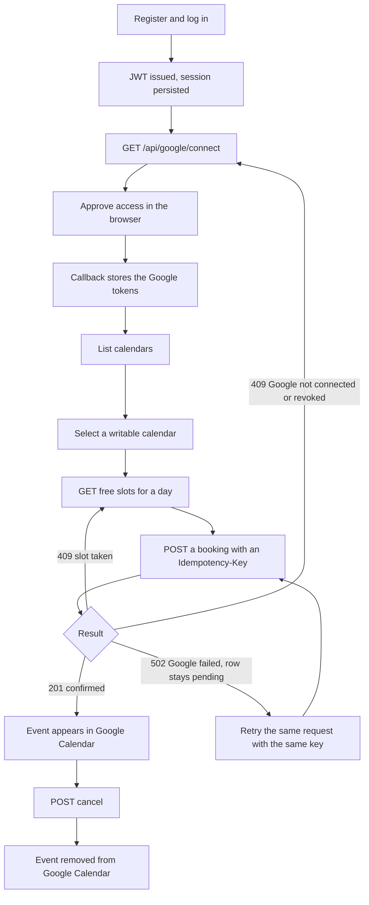
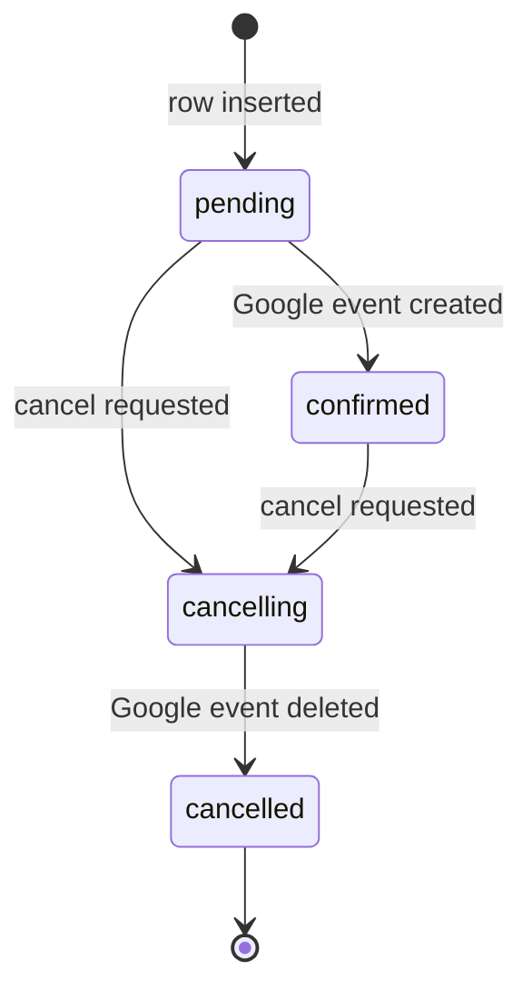
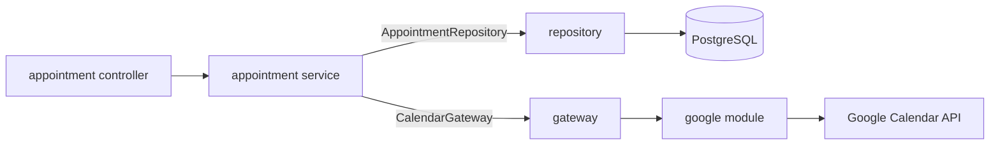
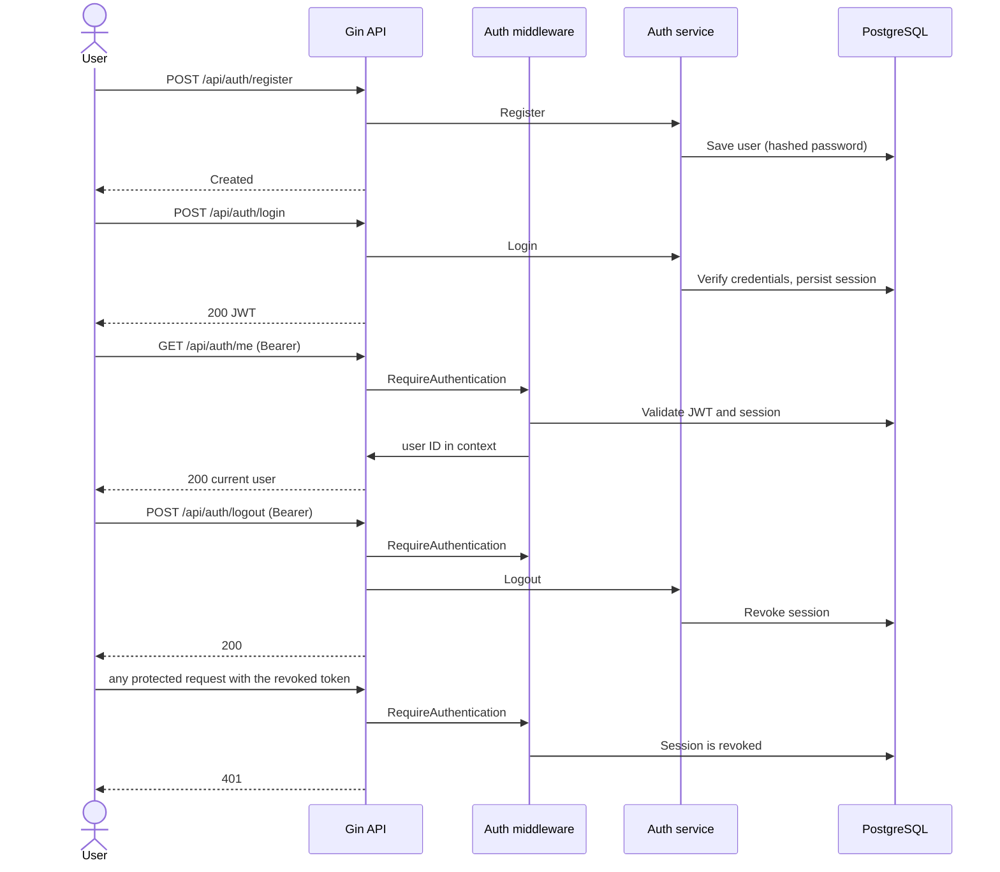
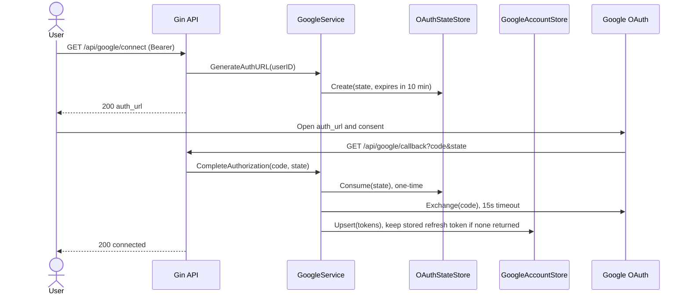
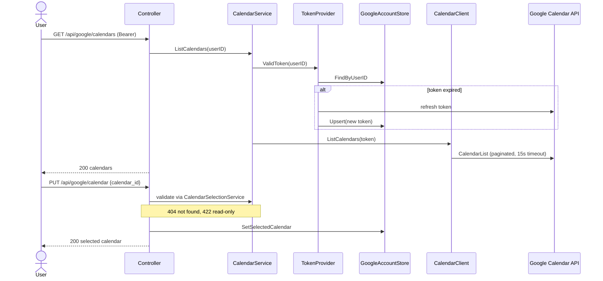
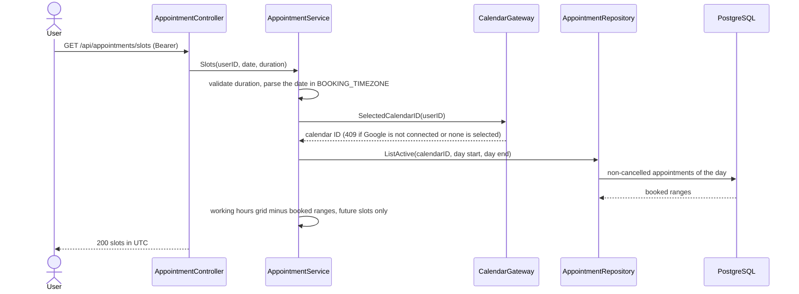
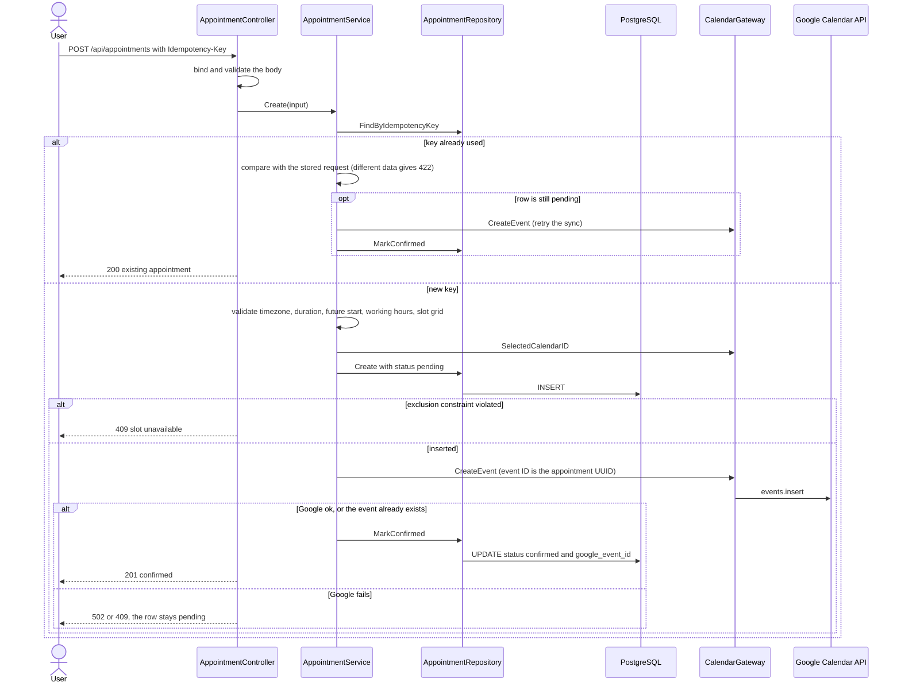
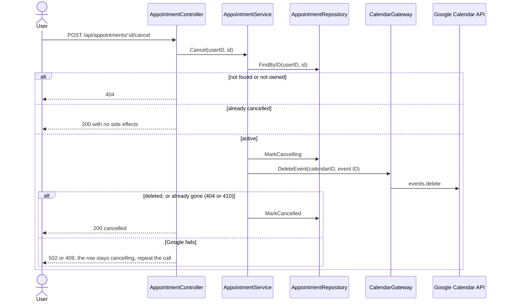

# Go Calendar Booking

A backend API for booking appointments that stay in sync with Google Calendar.
Users register and log in, connect their Google account, choose one calendar for bookings,
pick a free time slot, and book it. The booking is created automatically in the selected
Google Calendar, and cancelling it removes the event.


## Tech Stack

| Area | Technology |
|---|---|
| Language | Go |
| HTTP framework | Gin |
| Database | PostgreSQL |
| ORM | GORM |
| Authentication | JWT v5, bcrypt, persisted sessions |
| Google integration | `golang.org/x/oauth2`, `google.golang.org/api/calendar/v3` |
| Configuration | `godotenv` (`.env`) |
| Containers | Docker, Docker Compose (api, db, pgAdmin) |
| API testing | Postman |

## How the System Works

### The user journey



### In words

1. **Authentication.** The user registers and logs in and receives a JWT. Every login creates a persisted session, so logging out revokes the session and the token stops working even before it expires.
2. **Connecting Google.** `GET /api/google/connect` returns a Google authorization URL that carries a random, one-time `state`. After the user approves, Google calls `/api/google/callback`. The callback has no Bearer token, so the persisted `state` is what identifies the user. The app exchanges the code and stores the tokens.
3. **Choosing a calendar.** The user lists the calendars of the linked account and selects one. Only calendars where the user is `owner` or `writer` are accepted.
4. **Finding a free slot.** Slots are computed on request from the working hours in the environment, minus the active bookings on the selected calendar. The client receives slots as UTC instants.
5. **Booking.** The client sends the chosen `start_at`, a duration, an IANA timezone, and an `Idempotency-Key`. The app validates the request, saves the appointment as `pending` (PostgreSQL rejects overlaps), creates the Google event outside any DB transaction, and then marks the appointment `confirmed`.
6. **When Google fails.** The row stays `pending` and keeps its slot reserved. Repeating the same request with the same key finishes the sync without creating a duplicate.
7. **Cancelling.** The appointment moves to `cancelling`, the Google event is deleted (an already-deleted event counts as success), and the appointment becomes `cancelled`, which frees the slot.

### Appointment states



`pending` and `cancelling` are the explicit records that Google has not confirmed the change yet. Every state except `cancelled` holds its slot.

### Startup

`cmd/api/main.go` loads the configuration, connects to PostgreSQL, sets up request validation, then builds and migrates the modules in order: auth, google, appointment. The appointment module reads the `BOOKING_*` configuration and the app stops at startup if it is invalid. Its migration creates the table, enables `btree_gist`, and adds the no-overlap constraint. Then the routes are registered and the HTTP server starts with read and write timeouts and a graceful shutdown. The write timeout (30s) is higher than the Google call timeout (15s), so a `502` can always be written back.

## Architecture

Modular monolith organized by feature module.

```
cmd/api/main.go            # wiring, startup, graceful shutdown
internal/
├── common/
│   ├── config/            # environment configuration, including BOOKING_*
│   ├── database/
│   ├── middleware/        # authenticated user helpers
│   ├── response/          # JSON envelope and error responses
│   └── validator/         # request validation setup
└── modules/
    ├── auth/              # register, login, logout, sessions, current user
    ├── google/            # OAuth connection, calendar listing and selection, event writing
    └── appointment/       # slots, booking, listing, cancellation
        ├── controller/ dto/ gateway/ model/ repository/ service/
        └── migration.go module.go routes.go
```

Request flow:

```
Router -> Middleware -> Controller -> Service -> Repository (GORM/PostgreSQL) or Gateway (Google API) -> Response
```

| Layer | Responsibility |
|---|---|
| controller | HTTP requests, binding and validation, status codes, responses |
| service | Business logic and use cases. No Gin types |
| repository | Reading and writing data with GORM only |
| model | Domain entities and their states |
| dto | Request and response shapes |
| gateway | Talking to external services through contracts and their implementations |
| module.go | Creating components, wiring dependencies, running `Migrate()` |
| routes.go | Endpoints, handlers, and middleware |

Design rules:

- Constructor injection, no global state.
- Small consumer-side interfaces, defined in the package that uses them, so external dependencies can be faked in tests.
- Domain errors live in `service/errors.go` and are wrapped with `%w`. Controllers map them with `errors.Is`. SQL and provider errors are logged and never returned to clients.
- PostgreSQL is the source of truth. No DB transaction is held open during Google HTTP calls. Outbound calls use request contexts and a 15 second timeout.

### Module dependencies



The appointment service depends on contracts defined in `service/interfaces.go`. The repository and the gateway implement them. The Google module knows nothing about appointments. `appointment/module.go` wires the gateway with `gateway.NewCalendarGateway(googleModule.Accounts(), googleModule.Events())`.

### Auth module

Handles registration, login, logout, and the current user. Sessions are persisted, so logout revokes the session and a revoked token is rejected even if the JWT itself has not expired.

### Google module

An **integration module**: it owns the connection to Google and nothing about bookings.

| File | Responsibility |
|---|---|
| `service/oauth_config.go` | Builds the OAuth config |
| `service/oauth_state_store.go` | Creates and consumes one-time OAuth states |
| `service/google_account_store.go` | Reads and upserts the linked Google account and selected calendar |
| `service/token_provider.go` | Returns a valid access token, refreshing and persisting it when expired |
| `service/google_calendar_client.go` | The only code that calls the Google Calendar API (list, create event, delete event) |
| `service/google_calendar_service.go` | Token provider + client orchestration for listing calendars |
| `service/google_event_service.go` | Token provider + client orchestration for creating and deleting events |
| `service/calendar_selection_service.go` | Validates and saves the chosen calendar |
| `service/google_service.go` | OAuth flow: `GenerateAuthURL`, `CompleteAuthorization` |
| `controller/google_controller.go` | HTTP handlers and error mapping |

### Appointment module

Owns the booking rules. It reaches Google only through the gateway.

| File | Responsibility |
|---|---|
| `service/appointment_service.go` | Slots, create, get, list, cancel, and the sync with Google |
| `service/interfaces.go` | Contracts: `AppointmentService`, `AppointmentRepository`, `CalendarGateway` |
| `service/working_hours.go` | Working hours, slot generation, and slot validation |
| `service/errors.go` | Domain errors |
| `repository/appointment_repository.go` | GORM reads and writes, and database error translation |
| `gateway/calendar_gateway.go` | Adapter to the Google module, translates Google errors into appointment errors |
| `controller/appointment_controller.go` | HTTP handlers and error mapping |
| `dto/appointment_dto.go` | Request and response shapes |
| `migration.go` | Table, `btree_gist` extension, and the no-overlap constraint |

## Getting Started

### Prerequisites

- Docker and Docker Compose
- A Google Cloud project with the Google Calendar API enabled and an OAuth 2.0 **Web application** client

### 1. Clone

```bash
git clone <repository-url>
cd go-calendar-booking
```

### 2. Configure environment

```bash
cp .env.example .env
```

Fill in the values in `.env`. Never commit `.env`; only `.env.example` (without secrets) is tracked.

| Variable group | Notes |
|---|---|
| Server | Port and environment. See `.env.example`. |
| Database | PostgreSQL host, port, user, password, name. See `.env.example`. |
| JWT | Signing secret and token lifetime. See `.env.example`. |
| Google | Client ID, client secret, and redirect URL (see below). |
| Booking | Working hours and slot length (see below). All have defaults. |

Booking variables:

| Variable | Default | Description |
|---|---|---|
| `BOOKING_TIMEZONE` | `Africa/Cairo` | IANA timezone the working hours are defined in |
| `BOOKING_DAY_START` | `09:00` | Opening time |
| `BOOKING_DAY_END` | `17:00` | Closing time |
| `BOOKING_WORK_DAYS` | `sun,mon,tue,wed,thu` | Bookable days |
| `BOOKING_SLOT_MINUTES` | `30` | Slot length and start grid. Durations must be multiples of it |

Invalid booking values stop the app at startup. If `docker-compose.yml` lists environment variables one by one instead of using `env_file`, add the `BOOKING_*` variables there too.

### 3. Configure Google OAuth

1. In Google Cloud Console, create an OAuth client of type **Web application**.
2. Add the redirect URI. It must exactly match the redirect URL in your `.env`, for example:
   `http://localhost:8080/api/google/callback`
3. If the consent screen is in testing mode, add your Google account as a test user.
4. Scopes requested by the app:
   - `https://www.googleapis.com/auth/calendar.events`
   - `https://www.googleapis.com/auth/calendar.calendarlist.readonly`

### 4. Run with Docker Compose

```bash
docker compose --env-file .env up -d --build
```

This starts the services defined in `docker-compose.yml` (API, PostgreSQL, pgAdmin). Tables and the no-overlap constraint are created automatically on startup, and the migration is safe to run on every restart.

Useful commands:

```bash
docker compose ps                  # service status
docker compose logs -f api         # follow API logs
docker compose down                # stop services
docker compose down -v             # stop and delete the database volume
```

Health check:

```bash
curl http://localhost:8080/health
```

### 5. Try it

1. Import the Postman collection from `docs/` *(add the exported file)*.
2. Register and log in, then use the returned token as `Authorization: Bearer <jwt>`.
3. Call `GET /api/google/connect`, open the returned `auth_url` in a browser, and approve access.
4. Call `GET /api/google/calendars`, then `PUT /api/google/calendar` to choose a calendar.
5. Call `GET /api/appointments/slots?date=<a working day>&duration_minutes=30`.
6. Call `POST /api/appointments` with an `Idempotency-Key` header and a `start_at` copied from the slots response. Check that the event appears in Google Calendar.
7. Call `POST /api/appointments/<id>/cancel` and check that the event disappears.

Copy `start_at` from the slots response instead of computing it by hand, because the UTC offset of `BOOKING_TIMEZONE` can change with daylight saving time.

## Flows

### Authentication



### Connecting a Google account



### Listing and selecting a calendar



### Appointments: free slots



### Appointments: booking



No DB transaction is open while Google is called.

### Appointments: cancellation



## API Reference

All endpoints are under `/api`. Protected endpoints require:

```http
Authorization: Bearer <jwt>
```

Appointment endpoints return `{"data": ...}` on success. Errors use `{"error": "message"}` and add `"details"` for validation failures. The Google endpoints keep their own unwrapped bodies.

### Status codes

| Code | Meaning |
|---|---|
| 200 / 201 | Success (`200` also for an idempotent replay or a repeated cancel) |
| 400 | Bad input: missing `Idempotency-Key`, invalid timezone, date or id, malformed JSON |
| 401 | Unauthenticated |
| 404 | Missing or not owned |
| 409 | State conflict: slot unavailable, no calendar selected, Google not connected, authorization revoked |
| 422 | Valid input rejected by a rule: validation failed, invalid duration, start in the past, outside working hours, reused idempotency key with different data, read-only calendar |
| 502 | Google failure |
| 500 | Unexpected error. Logged, never exposed |

Binding validation errors in the appointment endpoints return `422` with `details` (malformed JSON returns `400`). The Google endpoints return `400` for a missing `calendar_id`.

### Auth

| Method | Endpoint | Auth | Description |
|---|---|---|---|
| POST | `/api/auth/register` | No | Register a new user |
| POST | `/api/auth/login` | No | Authenticate and issue a JWT |
| GET | `/api/auth/me` | Bearer | Return the authenticated user |
| POST | `/api/auth/logout` | Bearer | Revoke the current session |

Request and response bodies for these endpoints are in the Postman collection.

### Google

| Method | Endpoint | Auth | Description |
|---|---|---|---|
| GET | `/api/google/connect` | Bearer | Returns the Google authorization URL |
| GET | `/api/google/callback` | No (called by Google) | Completes OAuth; the user is identified by the persisted state |
| GET | `/api/google/calendars` | Bearer | Lists the calendars of the linked account |
| PUT | `/api/google/calendar` | Bearer | Selects the calendar used for bookings |
| GET | `/api/google/calendar` | Bearer | Returns the selected calendar |

**`GET /api/google/connect`**

```json
{ "auth_url": "https://accounts.google.com/o/oauth2/auth?..." }
```

**`GET /api/google/calendars`**

```json
{
  "calendars": [
    {
      "id": "user@example.com",
      "summary": "user@example.com",
      "primary": true,
      "accessRole": "owner",
      "timeZone": "UTC"
    }
  ]
}
```

**`PUT /api/google/calendar`**

```json
{ "calendar_id": "user@example.com" }
```

Response `200`:

```json
{ "calendar": { "id": "user@example.com", "summary": "user@example.com", "primary": true, "accessRole": "owner", "timeZone": "UTC" } }
```

| Case | Status |
|---|---|
| Missing `calendar_id` | 400 |
| Calendar not in the user's Google account | 404 |
| Calendar is read-only (not owner or writer) | 422 |
| Google not connected, or authorization revoked | 409 |
| Google API failure | 502 |

`GET /api/google/calendar` returns `404` when no calendar is selected.

### Appointments

| Method | Endpoint | Auth | Success | Errors |
|---|---|---|---|---|
| GET | `/api/appointments/slots?date=YYYY-MM-DD&duration_minutes=30` | Bearer | 200 | 400, 401, 409, 422 |
| POST | `/api/appointments` (header `Idempotency-Key`) | Bearer | 201, or 200 on replay | 400, 401, 409, 422, 502 |
| GET | `/api/appointments?from=&to=&limit=` | Bearer | 200 | 401, 422 |
| GET | `/api/appointments/:id` | Bearer | 200 | 400, 401, 404 |
| POST | `/api/appointments/:id/cancel` | Bearer | 200 | 400, 401, 404, 409, 502 |

`date` is read in `BOOKING_TIMEZONE`. `from` and `to` are RFC3339 (write `+` as `%2B` in a URL). `limit` is 1 to 100 and defaults to 50. Users only see their own appointments, and someone else's id returns `404`.

**`GET /api/appointments/slots?date=2026-11-01&duration_minutes=30`**

```json
{
  "data": [
    { "start_at": "2026-11-01T07:00:00Z", "end_at": "2026-11-01T07:30:00Z" },
    { "start_at": "2026-11-01T07:30:00Z", "end_at": "2026-11-01T08:00:00Z" }
  ]
}
```

**`POST /api/appointments`**

Header: `Idempotency-Key: <unique key per booking, max 255 characters>`

```json
{
  "title": "Consultation",
  "customer_name": "Ahmed",
  "customer_email": "ahmed@example.com",
  "start_at": "2026-11-01T07:00:00Z",
  "duration_minutes": 30,
  "timezone": "Africa/Cairo"
}
```

Response `201`:

```json
{
  "data": {
    "id": "6f1c2f0e-0000-0000-0000-000000000000",
    "calendar_id": "user@example.com",
    "title": "Consultation",
    "customer_name": "Ahmed",
    "customer_email": "ahmed@example.com",
    "start_at": "2026-11-01T07:00:00Z",
    "end_at": "2026-11-01T07:30:00Z",
    "timezone": "Africa/Cairo",
    "status": "confirmed",
    "google_event_id": "6f1c2f0e000000000000000000000000",
    "created_at": "2026-10-29T10:00:00Z"
  }
}
```

| Case | Status |
|---|---|
| Missing `Idempotency-Key`, invalid timezone | 400 |
| Validation failed (for example a bad email) | 422 with `details` |
| Duration not a multiple of the slot length, or longer than 8 hours | 422 |
| Start in the past, outside working hours, or not on the slot grid | 422 |
| Same key reused with different data | 422 |
| Same key and same data | 200 with the existing appointment |
| Slot already booked | 409 |
| No calendar selected, Google not connected, or authorization revoked | 409 |
| Google failed (the row stays `pending`, retry with the same key) | 502 |

## Edge Cases

| Edge case | How it is handled |
|---|---|
| Two users book the same time | A PostgreSQL exclusion constraint on `(calendar_id, tstzrange(start_at, end_at, '[)'))`, ignoring cancelled rows, rejects the second insert with `409`. A check in application code would leave a race between two concurrent requests, so the database decides. Adjacent bookings are allowed. |
| Google is slow, unavailable, or returns an error | Every call has a 15s timeout and errors become `502` (or `409` when the authorization is revoked). No DB transaction is open during Google calls. The row stays `pending` and a retry with the same key finishes the sync. |
| The same sync runs more than once | `Idempotency-Key` with a unique index per user. The Google event ID is the appointment UUID without dashes, so repeating the create never duplicates the event, and a `409` on insert counts as success. Delete treats `404` and `410` as success. Cancelling twice succeeds. |
| Timezones | Times are stored as UTC instants. The client sends an instant and an explicit IANA timezone, which is sent to Google as the event time zone. Slots are computed in `BOOKING_TIMEZONE` and never assume that the calendar's timezone matches the user's. |
| Handling of the external service's credentials | OAuth state is random, persisted, expires after 10 minutes, and works once. Access tokens are refreshed lazily and persisted. If Google returns no refresh token on reconnect, the stored one is kept. Tokens are never returned by the API and never logged. They are stored in plaintext today (see Known Limitations). |

## Decisions and Trade-offs

**Google module**

- **Google is only used to connect a calendar** to an existing user. There is no Google login or registration.
- **OAuth state:** cryptographically random, persisted, expires after 10 minutes, and consumed atomically so it works once. The callback has no Bearer token, so the state is what identifies the user.
- **Refresh tokens:** requested with offline access and `prompt=consent`. If Google returns no refresh token on reconnect, the stored one is kept.
- **Token refresh:** done lazily when the access token has expired, and the new token is persisted. Two concurrent requests may both refresh. Google allows this, so the cost is one extra request. A per-user lock was left out as over-engineering for this scope.
- **Provider failures:** every Google call has a 15 second timeout. Google errors are translated into domain errors. A 401 or insufficient-permission response becomes "authorization revoked" (`409`, reconnect). Other failures become `502`.
- **Selected calendar must be writable** (owner or writer), checked against the live calendar list at selection time.
- **`GET /api/google/calendar` calls Google** to confirm the calendar still exists, so it can return `502` when Google is down.
- **No DTO layer in the Google module:** `service.Calendar` carries JSON tags and is returned directly. This is a deliberate simplification that couples the service to the API shape.
- **Error mapping** is centralized in one function per controller instead of being repeated per handler.

**Appointment module**

- **The database prevents double booking.** The slots shown to the user are only suggestions. The exclusion constraint is the rule, and the booking request is also validated against the working hours and the slot grid, so a client cannot book outside the offered slots.
- **Availability comes from fixed working hours in the environment**, not from Google free/busy. This keeps PostgreSQL the single source of truth and avoids extra OAuth scopes. Events created directly in Google are not taken into account.
- **No cross-system atomicity is claimed.** The `pending` and `cancelling` states record that Google has not confirmed a change yet, and a retry finishes it.
- **The client sends an instant** (`start_at`) taken from the slots response, so there is no ambiguous local time such as a daylight saving gap.
- **Appointments depend on a small contract** (`CalendarGateway`) implemented by an adapter that translates Google errors into appointment errors. The Google module has no import of the appointment module.
- **The appointment endpoints use the shared `{"data": ...}` envelope.** The Google endpoints keep their unwrapped bodies so their existing contract does not change.

## Known Limitations

- Google tokens are stored in **plaintext**. Planned: AES-GCM encryption at rest with a key from the environment.
- A `pending` row that is never retried keeps its slot reserved. A cleanup job is the fix.
- A cancel that lands between the insert and the Google create of another request can leave an event in Google.
- One set of working hours for the whole app, not per user.
- Changes made directly in Google Calendar are not synced back.
- Expired and consumed OAuth states are never cleaned up.
- Reconnecting a different Google account keeps the old `selected_calendar_id`.
- A rejected authorization code (already used or expired) returns `502` rather than `400`.
- Schema changes rely on GORM `AutoMigrate` plus one raw SQL constraint. A migration tool such as goose or golang-migrate would be the production choice.

## Project Status

Edit this table so that "Verified manually" appears only on what was actually run.

| Area | State |
|---|---|
| Register, login, logout, JWT sessions, `/me` | Verified manually |
| Google OAuth connect and callback | Verified manually |
| List calendars | Verified manually |
| Calendar selection (`PUT`/`GET /api/google/calendar`) | Implemented, **not yet verified** |
| Appointments: slots, create, cancel | Verified manually (happy path) |
| Idempotent replay, overlap `409`, validation cases | Implemented, **not yet verified** |
| Concurrent booking (two parallel requests) | **Not verified** |
| Google failure, then retry with the same key | **Not verified** |
| Token refresh path, OAuth negative paths | **Not verified** |
| Token encryption at rest | Not implemented |
| Automated tests | Not implemented |

## Roadmap

1. Token encryption at rest (AES-GCM, key from the environment).
2. Automated tests with fakes for the Google client and token provider: concurrent booking, idempotent retry, cancellation, token refresh, OAuth state, and Google failures.
3. A cleanup job for stale `pending` appointments and expired OAuth states.
4. Per-user availability, and optionally free/busy from Google.
5. A migration tool instead of `AutoMigrate`.

